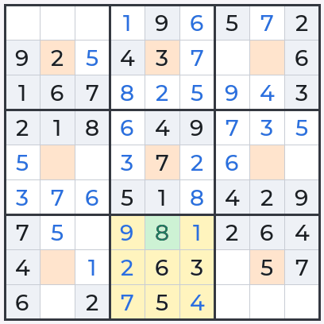

<!-- Written by tools/walkthrough.py center-dot: edit the script, not this page. -->
# Center Dot, step 30: the 8 in box 8

**Step 30 of 46** · [← Step 29](step-29.md) · [All steps](../center-dot.md#the-whole-puzzle-step-by-step) · [Step 31 →](step-31.md)

Box 8 needs an 8, and r7c5 is its last empty cell: **r7c5 = 8**.

**Step 30 of 46** · [← Step 29](step-29.md) · [All steps](../center-dot.md#the-whole-puzzle-step-by-step) · [Step 31 →](step-31.md)
