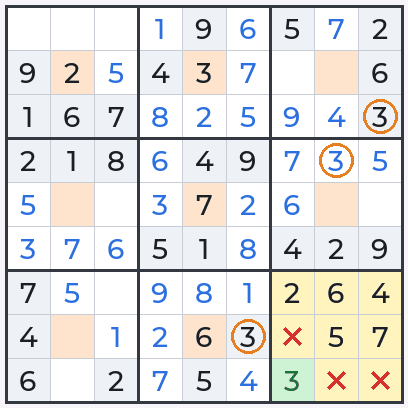

<!-- Written by tools/walkthrough.py center-dot: edit the script, not this page. -->
# Center Dot, step 31: the 3 in box 9

**Step 31 of 46** · [← Step 30](step-30.md) · [All steps](../center-dot.md#the-whole-puzzle-step-by-step) · [Step 32 →](step-32.md)

Box 9 needs a 3. r8c7: row 8 has one (r8c6). r9c8: column 8 has one (r4c8). r9c9: column 9 has one (r3c9). Only **r9c7** is left: **r9c7 = 3**.

**Step 31 of 46** · [← Step 30](step-30.md) · [All steps](../center-dot.md#the-whole-puzzle-step-by-step) · [Step 32 →](step-32.md)
