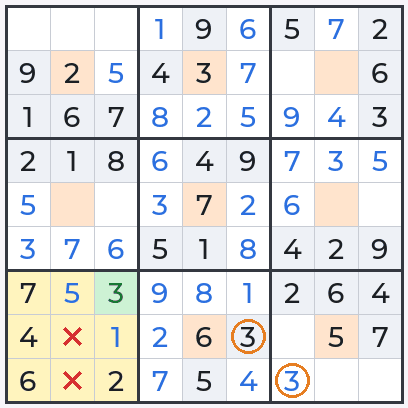

<!-- Written by tools/walkthrough.py center-dot: edit the script, not this page. -->
# Center Dot, step 32: the 3 in box 7

**Step 32 of 46** · [← Step 31](step-31.md) · [All steps](../center-dot.md#the-whole-puzzle-step-by-step) · [Step 33 →](step-33.md)

Box 7 needs a 3. r8c2: row 8 has one (r8c6). r9c2: row 9 has one (r9c7). Only **r7c3** is left: **r7c3 = 3**.

**Step 32 of 46** · [← Step 31](step-31.md) · [All steps](../center-dot.md#the-whole-puzzle-step-by-step) · [Step 33 →](step-33.md)
