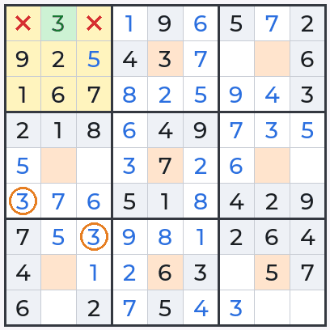

<!-- Written by tools/walkthrough.py center-dot: edit the script, not this page. -->
# Center Dot, step 33: the 3 in box 1

**Step 33 of 46** · [← Step 32](step-32.md) · [All steps](../center-dot.md#the-whole-puzzle-step-by-step) · [Step 34 →](step-34.md)

Box 1 needs a 3. r1c1: column 1 has one (r6c1). r1c3: column 3 has one (r7c3). Only **r1c2** is left: **r1c2 = 3**.

**Step 33 of 46** · [← Step 32](step-32.md) · [All steps](../center-dot.md#the-whole-puzzle-step-by-step) · [Step 34 →](step-34.md)
