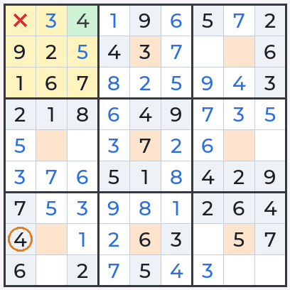

<!-- Written by tools/walkthrough.py center-dot: edit the script, not this page. -->
# Center Dot, step 34: the 4 in box 1

**Step 34 of 46** · [← Step 33](step-33.md) · [All steps](../center-dot.md#the-whole-puzzle-step-by-step) · [Step 35 →](step-35.md)

Box 1 needs a 4. r1c1: column 1 has one (r8c1). Only **r1c3** is left: **r1c3 = 4**.

**Step 34 of 46** · [← Step 33](step-33.md) · [All steps](../center-dot.md#the-whole-puzzle-step-by-step) · [Step 35 →](step-35.md)
