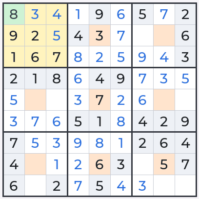

<!-- Written by tools/walkthrough.py center-dot: edit the script, not this page. -->
# Center Dot, step 35: the 8 in box 1

**Step 35 of 46** · [← Step 34](step-34.md) · [All steps](../center-dot.md#the-whole-puzzle-step-by-step) · [Step 36 →](step-36.md)

Box 1 needs an 8, and r1c1 is its last empty cell: **r1c1 = 8**.

**Step 35 of 46** · [← Step 34](step-34.md) · [All steps](../center-dot.md#the-whole-puzzle-step-by-step) · [Step 36 →](step-36.md)
