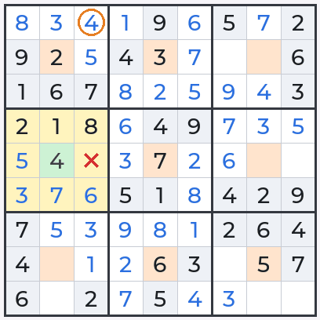

<!-- Written by tools/walkthrough.py center-dot: edit the script, not this page. -->
# Center Dot, step 36: the 4 in box 4

**Step 36 of 46** · [← Step 35](step-35.md) · [All steps](../center-dot.md#the-whole-puzzle-step-by-step) · [Step 37 →](step-37.md)

Box 4 needs a 4. r5c3: column 3 has one (r1c3). Only **r5c2** is left: **r5c2 = 4**.

**Step 36 of 46** · [← Step 35](step-35.md) · [All steps](../center-dot.md#the-whole-puzzle-step-by-step) · [Step 37 →](step-37.md)
