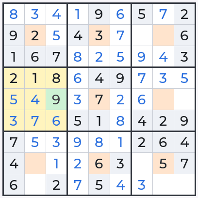

<!-- Written by tools/walkthrough.py center-dot: edit the script, not this page. -->
# Center Dot, step 37: the 9 in box 4

**Step 37 of 46** · [← Step 36](step-36.md) · [All steps](../center-dot.md#the-whole-puzzle-step-by-step) · [Step 38 →](step-38.md)

Box 4 needs a 9, and r5c3 is its last empty cell: **r5c3 = 9**.

**Step 37 of 46** · [← Step 36](step-36.md) · [All steps](../center-dot.md#the-whole-puzzle-step-by-step) · [Step 38 →](step-38.md)
