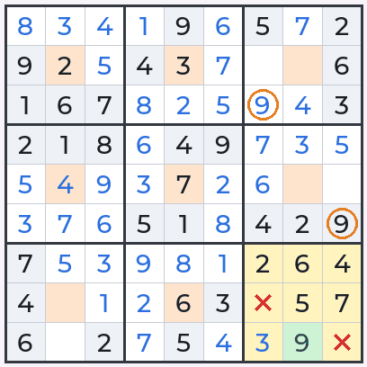

<!-- Written by tools/walkthrough.py center-dot: edit the script, not this page. -->
# Center Dot, step 38: the 9 in box 9

**Step 38 of 46** · [← Step 37](step-37.md) · [All steps](../center-dot.md#the-whole-puzzle-step-by-step) · [Step 39 →](step-39.md)

Box 9 needs a 9. r8c7: column 7 has one (r3c7). r9c9: column 9 has one (r6c9). Only **r9c8** is left: **r9c8 = 9**.

**Step 38 of 46** · [← Step 37](step-37.md) · [All steps](../center-dot.md#the-whole-puzzle-step-by-step) · [Step 39 →](step-39.md)
