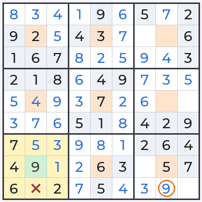

<!-- Written by tools/walkthrough.py center-dot: edit the script, not this page. -->
# Center Dot, step 39: the 9 in box 7

**Step 39 of 46** · [← Step 38](step-38.md) · [All steps](../center-dot.md#the-whole-puzzle-step-by-step) · [Step 40 →](step-40.md)

Box 7 needs a 9. r9c2: row 9 has one (r9c8). Only **r8c2** is left: **r8c2 = 9**.

**Step 39 of 46** · [← Step 38](step-38.md) · [All steps](../center-dot.md#the-whole-puzzle-step-by-step) · [Step 40 →](step-40.md)
