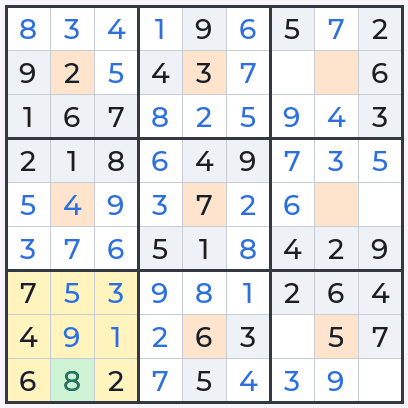

<!-- Written by tools/walkthrough.py center-dot: edit the script, not this page. -->
# Center Dot, step 40: the 8 in box 7

**Step 40 of 46** · [← Step 39](step-39.md) · [All steps](../center-dot.md#the-whole-puzzle-step-by-step) · [Step 41 →](step-41.md)

Box 7 needs an 8, and r9c2 is its last empty cell: **r9c2 = 8**.

**Step 40 of 46** · [← Step 39](step-39.md) · [All steps](../center-dot.md#the-whole-puzzle-step-by-step) · [Step 41 →](step-41.md)
