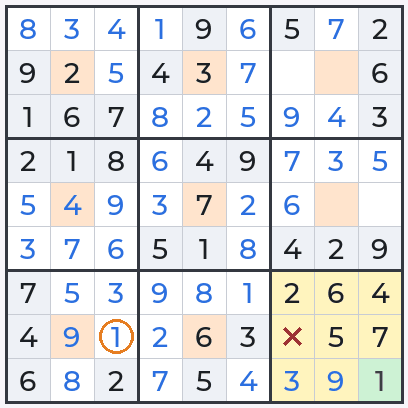

<!-- Written by tools/walkthrough.py center-dot: edit the script, not this page. -->
# Center Dot, step 41: the 1 in box 9

**Step 41 of 46** · [← Step 40](step-40.md) · [All steps](../center-dot.md#the-whole-puzzle-step-by-step) · [Step 42 →](step-42.md)

Box 9 needs a 1. r8c7: row 8 has one (r8c3). Only **r9c9** is left: **r9c9 = 1**.

**Step 41 of 46** · [← Step 40](step-40.md) · [All steps](../center-dot.md#the-whole-puzzle-step-by-step) · [Step 42 →](step-42.md)
