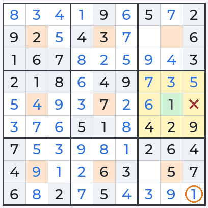

<!-- Written by tools/walkthrough.py center-dot: edit the script, not this page. -->
# Center Dot, step 42: the 1 in box 6

**Step 42 of 46** · [← Step 41](step-41.md) · [All steps](../center-dot.md#the-whole-puzzle-step-by-step) · [Step 43 →](step-43.md)

Box 6 needs a 1. r5c9: column 9 has one (r9c9). Only **r5c8** is left: **r5c8 = 1**.

**Step 42 of 46** · [← Step 41](step-41.md) · [All steps](../center-dot.md#the-whole-puzzle-step-by-step) · [Step 43 →](step-43.md)
