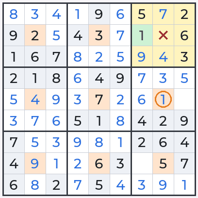

<!-- Written by tools/walkthrough.py center-dot: edit the script, not this page. -->
# Center Dot, step 43: the 1 in box 3

**Step 43 of 46** · [← Step 42](step-42.md) · [All steps](../center-dot.md#the-whole-puzzle-step-by-step) · [Step 44 →](step-44.md)

Box 3 needs a 1. r2c8: column 8 has one (r5c8). Only **r2c7** is left: **r2c7 = 1**.

**Step 43 of 46** · [← Step 42](step-42.md) · [All steps](../center-dot.md#the-whole-puzzle-step-by-step) · [Step 44 →](step-44.md)
