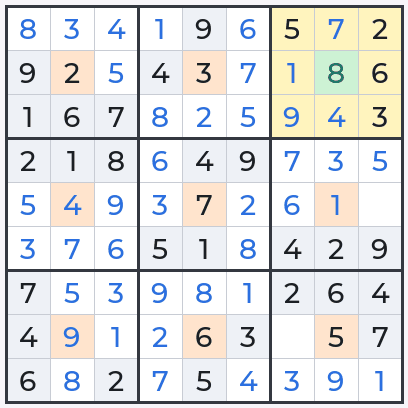

<!-- Written by tools/walkthrough.py center-dot: edit the script, not this page. -->
# Center Dot, step 44: the 8 in box 3

**Step 44 of 46** · [← Step 43](step-43.md) · [All steps](../center-dot.md#the-whole-puzzle-step-by-step) · [Step 45 →](step-45.md)

Box 3 needs an 8, and r2c8 is its last empty cell: **r2c8 = 8**.

**Step 44 of 46** · [← Step 43](step-43.md) · [All steps](../center-dot.md#the-whole-puzzle-step-by-step) · [Step 45 →](step-45.md)
