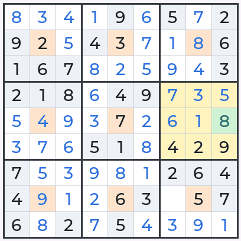

<!-- Written by tools/walkthrough.py center-dot: edit the script, not this page. -->
# Center Dot, step 45: the 8 in box 6

**Step 45 of 46** · [← Step 44](step-44.md) · [All steps](../center-dot.md#the-whole-puzzle-step-by-step) · [Step 46 →](step-46.md)

Box 6 needs an 8, and r5c9 is its last empty cell: **r5c9 = 8**.

**Step 45 of 46** · [← Step 44](step-44.md) · [All steps](../center-dot.md#the-whole-puzzle-step-by-step) · [Step 46 →](step-46.md)
