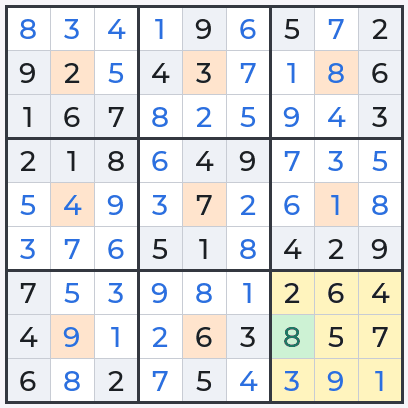

<!-- Written by tools/walkthrough.py center-dot: edit the script, not this page. -->
# Center Dot, step 46: the 8 in box 9

**Step 46 of 46** · [← Step 45](step-45.md) · [All steps](../center-dot.md#the-whole-puzzle-step-by-step) · [All steps](../center-dot.md#the-whole-puzzle-step-by-step)

Box 9 needs an 8, and r8c7 is its last empty cell: **r8c7 = 8**.

Solved.

**Step 46 of 46** · [← Step 45](step-45.md) · [All steps](../center-dot.md#the-whole-puzzle-step-by-step) · [All steps](../center-dot.md#the-whole-puzzle-step-by-step)
