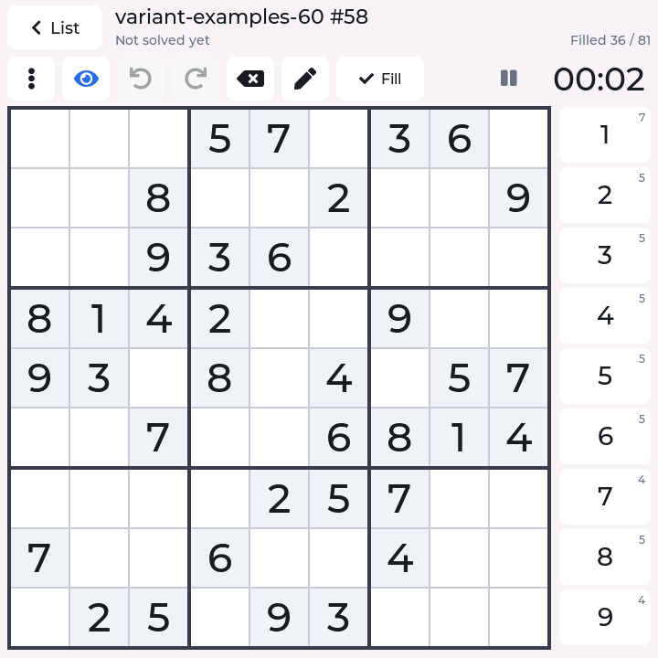
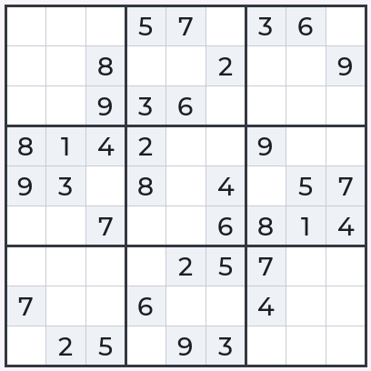

# Chess Sudoku

[← All variants](README.md) · [Puzzles](../features-puzzles.md) · [How to play](../how-to-play.md)

## The rules

[Classic](classic.md) rules, and two chess pieces' moves: **no digit repeats a knight's move apart** (two cells one way and one the other, as in [Anti-Knight](anti-knight.md)), and **none in cells that touch**, corners included (a king's move, as in [Anti-King](anti-king.md)). Every digit rules out up to 12 cells beyond its row, column and box.

## On the board

- Nothing extra is drawn: the rule is everywhere.
- Two of the same digit a knight's move apart, or touching, turn red.
- The hints count the moves as more cells a digit sees: "row, column, box, a knight's move away or a touching cell".
- **Puzzles → ⋮ → New puzzle → Marks → Chess.** With both rules, puzzles need few givens: Expert keeps about 11.

## How to solve it

- **Each digit is a wide blocker:** around it, the 8 knight's-move cells and the 4 corner cells can't hold it, as well as its row, column and box.
- **Look in the next box over:** a digit near a box's edge rules out cells two columns or rows away, in the neighbouring box, by a knight's move.
- **The corner cells matter most** where boxes meet: two cells diagonally across a box corner can't match.

## Worked example

**variant-examples #58**, Chess Sudoku Easy (see [Classic](classic.md#worked-example-the-whole-puzzle) for how to import the examples; cells are written r*row*c*column*).

**Step 1: r2c4.** Row 2 has 2, 8 and 9; column 4 has 3, 5 and 6; box 2 has 7: that leaves 1 and 4. The 4 in r4c3 is a knight's move away (two rows down, one column left). **r2c4 = 1**.

**Step 2: r1c3.** Row 1 has 3, 5, 6 and 7; column 3 has 4, 8 and 9: that leaves 1 and 2. The 1 just placed in r2c4 touches r1c3 at a corner. **r1c3 = 2**.

**Step 3: r3c1.** Column 1 has 7 and 8; row 3 has 3, 6 and 9; box 1 has 2: that leaves 1, 4 and 5. The 1 in r4c2 touches it at a corner, and the 4 in r4c3 is a knight's move away. **r3c1 = 5**.

## The whole puzzle, step by step

<!-- walkthrough -->
<!-- Written by tools/walkthrough.py chess-sudoku: edit the script, not this part. -->

The whole puzzle, from the start to the last cell: 45 steps, each one a single (one place left for a digit, or one digit left for a cell), taken in the order a box's single comes first, so not quite the order of the worked example above. Each step has a page of its own, with **Previous** and **Next**: pick its number below. In each picture, the unit the step looks at is tinted yellow (for a cell with one digit left: its row, column and box), the new digit is on green, the digits that rule cells out have an **orange ring**, and the empty cells they rule out a **red cross**. Givens are on grey, digits from earlier steps in blue.

| [1](chess-sudoku/step-01.md) | [2](chess-sudoku/step-02.md) | [3](chess-sudoku/step-03.md) | [4](chess-sudoku/step-04.md) | [5](chess-sudoku/step-05.md) | [6](chess-sudoku/step-06.md) | [7](chess-sudoku/step-07.md) | [8](chess-sudoku/step-08.md) | [9](chess-sudoku/step-09.md) | [10](chess-sudoku/step-10.md) |
|:-:|:-:|:-:|:-:|:-:|:-:|:-:|:-:|:-:|:-:|
| [11](chess-sudoku/step-11.md) | [12](chess-sudoku/step-12.md) | [13](chess-sudoku/step-13.md) | [14](chess-sudoku/step-14.md) | [15](chess-sudoku/step-15.md) | [16](chess-sudoku/step-16.md) | [17](chess-sudoku/step-17.md) | [18](chess-sudoku/step-18.md) | [19](chess-sudoku/step-19.md) | [20](chess-sudoku/step-20.md) |
| [21](chess-sudoku/step-21.md) | [22](chess-sudoku/step-22.md) | [23](chess-sudoku/step-23.md) | [24](chess-sudoku/step-24.md) | [25](chess-sudoku/step-25.md) | [26](chess-sudoku/step-26.md) | [27](chess-sudoku/step-27.md) | [28](chess-sudoku/step-28.md) | [29](chess-sudoku/step-29.md) | [30](chess-sudoku/step-30.md) |
| [31](chess-sudoku/step-31.md) | [32](chess-sudoku/step-32.md) | [33](chess-sudoku/step-33.md) | [34](chess-sudoku/step-34.md) | [35](chess-sudoku/step-35.md) | [36](chess-sudoku/step-36.md) | [37](chess-sudoku/step-37.md) | [38](chess-sudoku/step-38.md) | [39](chess-sudoku/step-39.md) | [40](chess-sudoku/step-40.md) |
| [41](chess-sudoku/step-41.md) | [42](chess-sudoku/step-42.md) | [43](chess-sudoku/step-43.md) | [44](chess-sudoku/step-44.md) | [45](chess-sudoku/step-45.md) |  |  |  |  |  |

Solved.

<!-- /walkthrough -->
