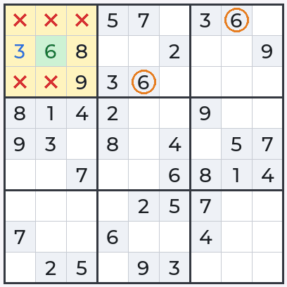

<!-- Written by tools/walkthrough.py chess-sudoku: edit the script, not this page. -->
# Chess Sudoku, step 2: the 6 in box 1

**Step 2 of 45** · [← Step 1](step-01.md) · [All steps](../chess-sudoku.md#the-whole-puzzle-step-by-step) · [Step 3 →](step-03.md)

Box 1 needs a 6. r1c1, r1c2 and r1c3: row 1 has one (r1c8). r3c1 and r3c2: row 3 has one (r3c5). Only **r2c2** is left: **r2c2 = 6**.

**Step 2 of 45** · [← Step 1](step-01.md) · [All steps](../chess-sudoku.md#the-whole-puzzle-step-by-step) · [Step 3 →](step-03.md)
