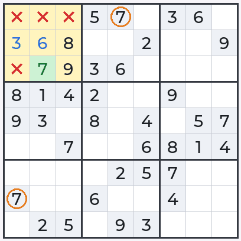

<!-- Written by tools/walkthrough.py chess-sudoku: edit the script, not this page. -->
# Chess Sudoku, step 3: the 7 in box 1

**Step 3 of 45** · [← Step 2](step-02.md) · [All steps](../chess-sudoku.md#the-whole-puzzle-step-by-step) · [Step 4 →](step-04.md)

Box 1 needs a 7. r1c1, r1c2 and r1c3: row 1 has one (r1c5). r3c1: column 1 has one (r8c1). Only **r3c2** is left: **r3c2 = 7**.

**Step 3 of 45** · [← Step 2](step-02.md) · [All steps](../chess-sudoku.md#the-whole-puzzle-step-by-step) · [Step 4 →](step-04.md)
