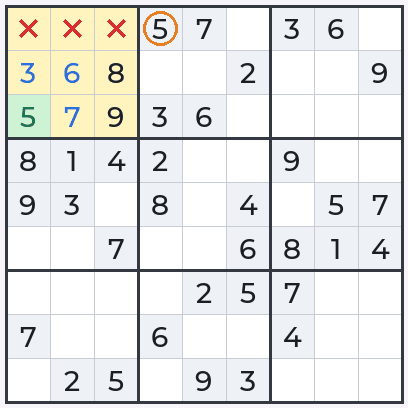

<!-- Written by tools/walkthrough.py chess-sudoku: edit the script, not this page. -->
# Chess Sudoku, step 4: the 5 in box 1

**Step 4 of 45** · [← Step 3](step-03.md) · [All steps](../chess-sudoku.md#the-whole-puzzle-step-by-step) · [Step 5 →](step-05.md)

Box 1 needs a 5. r1c1, r1c2 and r1c3: row 1 has one (r1c4). Only **r3c1** is left: **r3c1 = 5**.

**Step 4 of 45** · [← Step 3](step-03.md) · [All steps](../chess-sudoku.md#the-whole-puzzle-step-by-step) · [Step 5 →](step-05.md)
