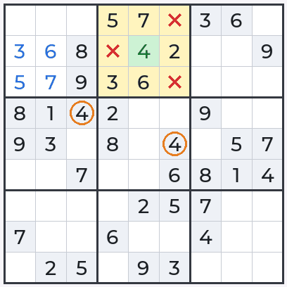

<!-- Written by tools/walkthrough.py chess-sudoku: edit the script, not this page. -->
# Chess Sudoku, step 5: the 4 in box 2

**Step 5 of 45** · [← Step 4](step-04.md) · [All steps](../chess-sudoku.md#the-whole-puzzle-step-by-step) · [Step 6 →](step-06.md)

Box 2 needs a 4. r1c6 and r3c6: column 6 has one (r5c6). r2c4: the 4 in r4c3 is a knight's move away. Only **r2c5** is left: **r2c5 = 4**.

**Step 5 of 45** · [← Step 4](step-04.md) · [All steps](../chess-sudoku.md#the-whole-puzzle-step-by-step) · [Step 6 →](step-06.md)
