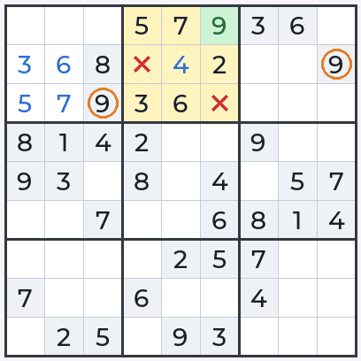

<!-- Written by tools/walkthrough.py chess-sudoku: edit the script, not this page. -->
# Chess Sudoku, step 6: the 9 in box 2

**Step 6 of 45** · [← Step 5](step-05.md) · [All steps](../chess-sudoku.md#the-whole-puzzle-step-by-step) · [Step 7 →](step-07.md)

Box 2 needs a 9. r2c4: row 2 has one (r2c9). r3c6: row 3 has one (r3c3). Only **r1c6** is left: **r1c6 = 9**.

**Step 6 of 45** · [← Step 5](step-05.md) · [All steps](../chess-sudoku.md#the-whole-puzzle-step-by-step) · [Step 7 →](step-07.md)
