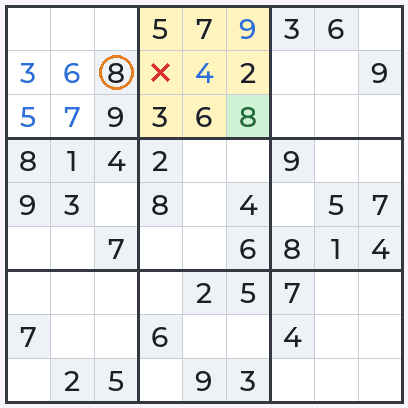

<!-- Written by tools/walkthrough.py chess-sudoku: edit the script, not this page. -->
# Chess Sudoku, step 7: the 8 in box 2

**Step 7 of 45** · [← Step 6](step-06.md) · [All steps](../chess-sudoku.md#the-whole-puzzle-step-by-step) · [Step 8 →](step-08.md)

Box 2 needs an 8. r2c4: row 2 has one (r2c3). Only **r3c6** is left: **r3c6 = 8**.

**Step 7 of 45** · [← Step 6](step-06.md) · [All steps](../chess-sudoku.md#the-whole-puzzle-step-by-step) · [Step 8 →](step-08.md)
