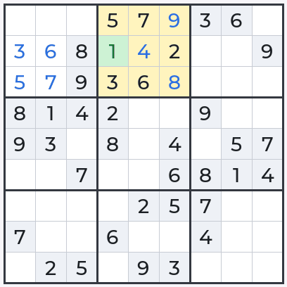

<!-- Written by tools/walkthrough.py chess-sudoku: edit the script, not this page. -->
# Chess Sudoku, step 8: the 1 in box 2

**Step 8 of 45** · [← Step 7](step-07.md) · [All steps](../chess-sudoku.md#the-whole-puzzle-step-by-step) · [Step 9 →](step-09.md)

Box 2 needs a 1, and r2c4 is its last empty cell: **r2c4 = 1**.

**Step 8 of 45** · [← Step 7](step-07.md) · [All steps](../chess-sudoku.md#the-whole-puzzle-step-by-step) · [Step 9 →](step-09.md)
