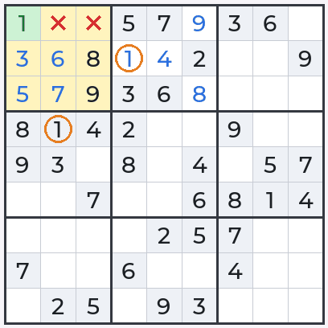

<!-- Written by tools/walkthrough.py chess-sudoku: edit the script, not this page. -->
# Chess Sudoku, step 9: the 1 in box 1

**Step 9 of 45** · [← Step 8](step-08.md) · [All steps](../chess-sudoku.md#the-whole-puzzle-step-by-step) · [Step 10 →](step-10.md)

Box 1 needs a 1. r1c2: column 2 has one (r4c2). r1c3: touches the 1 in r2c4 at a corner. Only **r1c1** is left: **r1c1 = 1**.

**Step 9 of 45** · [← Step 8](step-08.md) · [All steps](../chess-sudoku.md#the-whole-puzzle-step-by-step) · [Step 10 →](step-10.md)
