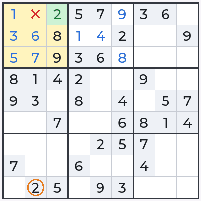

<!-- Written by tools/walkthrough.py chess-sudoku: edit the script, not this page. -->
# Chess Sudoku, step 10: the 2 in box 1

**Step 10 of 45** · [← Step 9](step-09.md) · [All steps](../chess-sudoku.md#the-whole-puzzle-step-by-step) · [Step 11 →](step-11.md)

Box 1 needs a 2. r1c2: column 2 has one (r9c2). Only **r1c3** is left: **r1c3 = 2**.

**Step 10 of 45** · [← Step 9](step-09.md) · [All steps](../chess-sudoku.md#the-whole-puzzle-step-by-step) · [Step 11 →](step-11.md)
