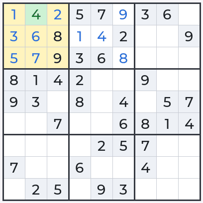

<!-- Written by tools/walkthrough.py chess-sudoku: edit the script, not this page. -->
# Chess Sudoku, step 11: the 4 in box 1

**Step 11 of 45** · [← Step 10](step-10.md) · [All steps](../chess-sudoku.md#the-whole-puzzle-step-by-step) · [Step 12 →](step-12.md)

Box 1 needs a 4, and r1c2 is its last empty cell: **r1c2 = 4**.

**Step 11 of 45** · [← Step 10](step-10.md) · [All steps](../chess-sudoku.md#the-whole-puzzle-step-by-step) · [Step 12 →](step-12.md)
