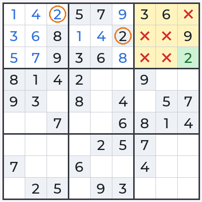

<!-- Written by tools/walkthrough.py chess-sudoku: edit the script, not this page. -->
# Chess Sudoku, step 12: the 2 in box 3

**Step 12 of 45** · [← Step 11](step-11.md) · [All steps](../chess-sudoku.md#the-whole-puzzle-step-by-step) · [Step 13 →](step-13.md)

Box 3 needs a 2. r1c9: row 1 has one (r1c3). r2c7 and r2c8: row 2 has one (r2c6). r3c7: touches the 2 in r2c6 at a corner. r3c8: the 2 in r2c6 is a knight's move away. Only **r3c9** is left: **r3c9 = 2**.

**Step 12 of 45** · [← Step 11](step-11.md) · [All steps](../chess-sudoku.md#the-whole-puzzle-step-by-step) · [Step 13 →](step-13.md)
