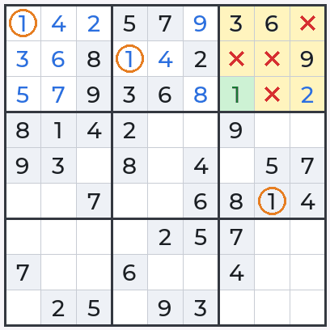

<!-- Written by tools/walkthrough.py chess-sudoku: edit the script, not this page. -->
# Chess Sudoku, step 13: the 1 in box 3

**Step 13 of 45** · [← Step 12](step-12.md) · [All steps](../chess-sudoku.md#the-whole-puzzle-step-by-step) · [Step 14 →](step-14.md)

Box 3 needs a 1. r1c9: row 1 has one (r1c1). r2c7 and r2c8: row 2 has one (r2c4). r3c8: column 8 has one (r6c8). Only **r3c7** is left: **r3c7 = 1**.

**Step 13 of 45** · [← Step 12](step-12.md) · [All steps](../chess-sudoku.md#the-whole-puzzle-step-by-step) · [Step 14 →](step-14.md)
