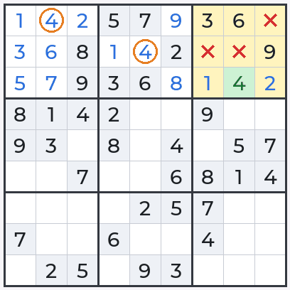

<!-- Written by tools/walkthrough.py chess-sudoku: edit the script, not this page. -->
# Chess Sudoku, step 14: the 4 in box 3

**Step 14 of 45** · [← Step 13](step-13.md) · [All steps](../chess-sudoku.md#the-whole-puzzle-step-by-step) · [Step 15 →](step-15.md)

Box 3 needs a 4. r1c9: row 1 has one (r1c2). r2c7 and r2c8: row 2 has one (r2c5). Only **r3c8** is left: **r3c8 = 4**.

**Step 14 of 45** · [← Step 13](step-13.md) · [All steps](../chess-sudoku.md#the-whole-puzzle-step-by-step) · [Step 15 →](step-15.md)
