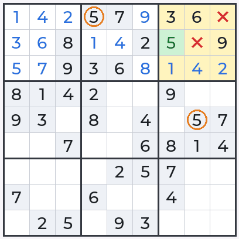

<!-- Written by tools/walkthrough.py chess-sudoku: edit the script, not this page. -->
# Chess Sudoku, step 15: the 5 in box 3

**Step 15 of 45** · [← Step 14](step-14.md) · [All steps](../chess-sudoku.md#the-whole-puzzle-step-by-step) · [Step 16 →](step-16.md)

Box 3 needs a 5. r1c9: row 1 has one (r1c4). r2c8: column 8 has one (r5c8). Only **r2c7** is left: **r2c7 = 5**.

**Step 15 of 45** · [← Step 14](step-14.md) · [All steps](../chess-sudoku.md#the-whole-puzzle-step-by-step) · [Step 16 →](step-16.md)
