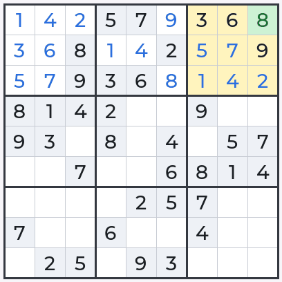

<!-- Written by tools/walkthrough.py chess-sudoku: edit the script, not this page. -->
# Chess Sudoku, step 17: the 8 in box 3

**Step 17 of 45** · [← Step 16](step-16.md) · [All steps](../chess-sudoku.md#the-whole-puzzle-step-by-step) · [Step 18 →](step-18.md)

Box 3 needs an 8, and r1c9 is its last empty cell: **r1c9 = 8**.

**Step 17 of 45** · [← Step 16](step-16.md) · [All steps](../chess-sudoku.md#the-whole-puzzle-step-by-step) · [Step 18 →](step-18.md)
