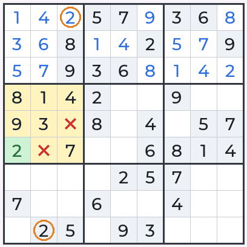

<!-- Written by tools/walkthrough.py chess-sudoku: edit the script, not this page. -->
# Chess Sudoku, step 18: the 2 in box 4

**Step 18 of 45** · [← Step 17](step-17.md) · [All steps](../chess-sudoku.md#the-whole-puzzle-step-by-step) · [Step 19 →](step-19.md)

Box 4 needs a 2. r5c3: column 3 has one (r1c3). r6c2: column 2 has one (r9c2). Only **r6c1** is left: **r6c1 = 2**.

**Step 18 of 45** · [← Step 17](step-17.md) · [All steps](../chess-sudoku.md#the-whole-puzzle-step-by-step) · [Step 19 →](step-19.md)
