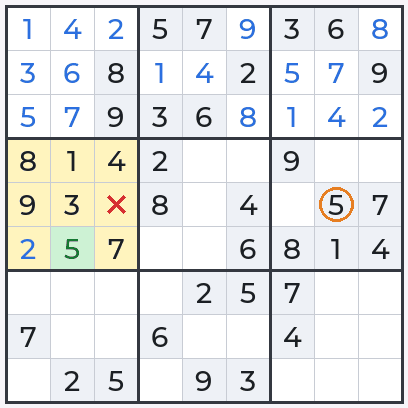

<!-- Written by tools/walkthrough.py chess-sudoku: edit the script, not this page. -->
# Chess Sudoku, step 19: the 5 in box 4

**Step 19 of 45** · [← Step 18](step-18.md) · [All steps](../chess-sudoku.md#the-whole-puzzle-step-by-step) · [Step 20 →](step-20.md)

Box 4 needs a 5. r5c3: row 5 has one (r5c8). Only **r6c2** is left: **r6c2 = 5**.

**Step 19 of 45** · [← Step 18](step-18.md) · [All steps](../chess-sudoku.md#the-whole-puzzle-step-by-step) · [Step 20 →](step-20.md)
