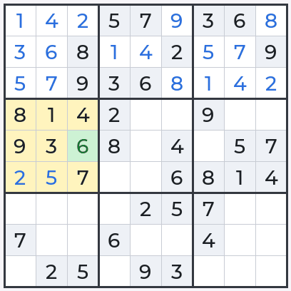

<!-- Written by tools/walkthrough.py chess-sudoku: edit the script, not this page. -->
# Chess Sudoku, step 20: the 6 in box 4

**Step 20 of 45** · [← Step 19](step-19.md) · [All steps](../chess-sudoku.md#the-whole-puzzle-step-by-step) · [Step 21 →](step-21.md)

Box 4 needs a 6, and r5c3 is its last empty cell: **r5c3 = 6**.

**Step 20 of 45** · [← Step 19](step-19.md) · [All steps](../chess-sudoku.md#the-whole-puzzle-step-by-step) · [Step 21 →](step-21.md)
