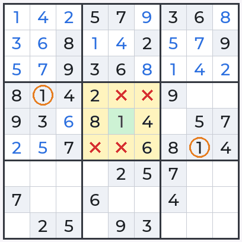

<!-- Written by tools/walkthrough.py chess-sudoku: edit the script, not this page. -->
# Chess Sudoku, step 21: the 1 in box 5

**Step 21 of 45** · [← Step 20](step-20.md) · [All steps](../chess-sudoku.md#the-whole-puzzle-step-by-step) · [Step 22 →](step-22.md)

Box 5 needs a 1. r4c5 and r4c6: row 4 has one (r4c2). r6c4 and r6c5: row 6 has one (r6c8). Only **r5c5** is left: **r5c5 = 1**.

**Step 21 of 45** · [← Step 20](step-20.md) · [All steps](../chess-sudoku.md#the-whole-puzzle-step-by-step) · [Step 22 →](step-22.md)
