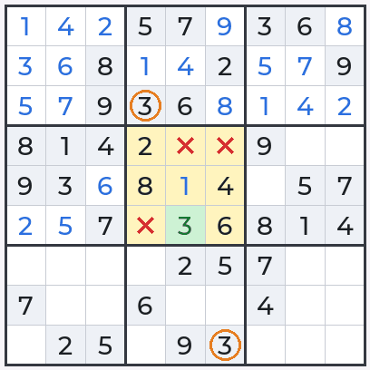

<!-- Written by tools/walkthrough.py chess-sudoku: edit the script, not this page. -->
# Chess Sudoku, step 22: the 3 in box 5

**Step 22 of 45** · [← Step 21](step-21.md) · [All steps](../chess-sudoku.md#the-whole-puzzle-step-by-step) · [Step 23 →](step-23.md)

Box 5 needs a 3. r4c5: touches the 3 in r3c4 at a corner. r4c6: column 6 has one (r9c6). r6c4: column 4 has one (r3c4). Only **r6c5** is left: **r6c5 = 3**.

**Step 22 of 45** · [← Step 21](step-21.md) · [All steps](../chess-sudoku.md#the-whole-puzzle-step-by-step) · [Step 23 →](step-23.md)
