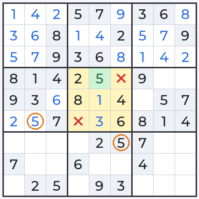

<!-- Written by tools/walkthrough.py chess-sudoku: edit the script, not this page. -->
# Chess Sudoku, step 23: the 5 in box 5

**Step 23 of 45** · [← Step 22](step-22.md) · [All steps](../chess-sudoku.md#the-whole-puzzle-step-by-step) · [Step 24 →](step-24.md)

Box 5 needs a 5. r4c6: column 6 has one (r7c6). r6c4: row 6 has one (r6c2). Only **r4c5** is left: **r4c5 = 5**.

**Step 23 of 45** · [← Step 22](step-22.md) · [All steps](../chess-sudoku.md#the-whole-puzzle-step-by-step) · [Step 24 →](step-24.md)
