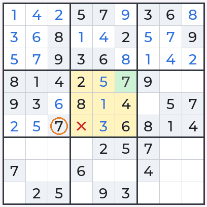

<!-- Written by tools/walkthrough.py chess-sudoku: edit the script, not this page. -->
# Chess Sudoku, step 24: the 7 in box 5

**Step 24 of 45** · [← Step 23](step-23.md) · [All steps](../chess-sudoku.md#the-whole-puzzle-step-by-step) · [Step 25 →](step-25.md)

Box 5 needs a 7. r6c4: row 6 has one (r6c3). Only **r4c6** is left: **r4c6 = 7**.

**Step 24 of 45** · [← Step 23](step-23.md) · [All steps](../chess-sudoku.md#the-whole-puzzle-step-by-step) · [Step 25 →](step-25.md)
