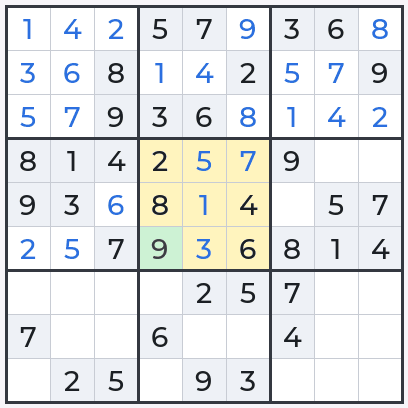

<!-- Written by tools/walkthrough.py chess-sudoku: edit the script, not this page. -->
# Chess Sudoku, step 25: the 9 in box 5

**Step 25 of 45** · [← Step 24](step-24.md) · [All steps](../chess-sudoku.md#the-whole-puzzle-step-by-step) · [Step 26 →](step-26.md)

Box 5 needs a 9, and r6c4 is its last empty cell: **r6c4 = 9**.

**Step 25 of 45** · [← Step 24](step-24.md) · [All steps](../chess-sudoku.md#the-whole-puzzle-step-by-step) · [Step 26 →](step-26.md)
