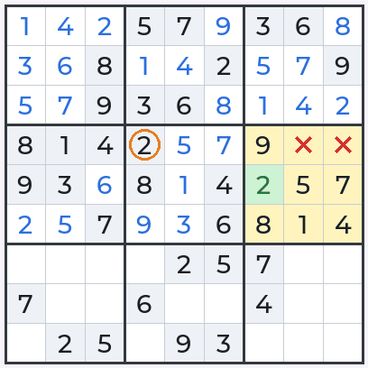

<!-- Written by tools/walkthrough.py chess-sudoku: edit the script, not this page. -->
# Chess Sudoku, step 26: the 2 in box 6

**Step 26 of 45** · [← Step 25](step-25.md) · [All steps](../chess-sudoku.md#the-whole-puzzle-step-by-step) · [Step 27 →](step-27.md)

Box 6 needs a 2. r4c8 and r4c9: row 4 has one (r4c4). Only **r5c7** is left: **r5c7 = 2**.

**Step 26 of 45** · [← Step 25](step-25.md) · [All steps](../chess-sudoku.md#the-whole-puzzle-step-by-step) · [Step 27 →](step-27.md)
