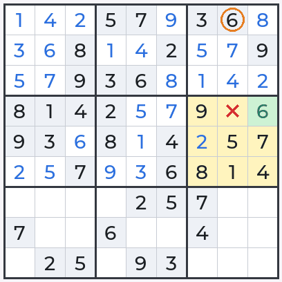

<!-- Written by tools/walkthrough.py chess-sudoku: edit the script, not this page. -->
# Chess Sudoku, step 27: the 6 in box 6

**Step 27 of 45** · [← Step 26](step-26.md) · [All steps](../chess-sudoku.md#the-whole-puzzle-step-by-step) · [Step 28 →](step-28.md)

Box 6 needs a 6. r4c8: column 8 has one (r1c8). Only **r4c9** is left: **r4c9 = 6**.

**Step 27 of 45** · [← Step 26](step-26.md) · [All steps](../chess-sudoku.md#the-whole-puzzle-step-by-step) · [Step 28 →](step-28.md)
