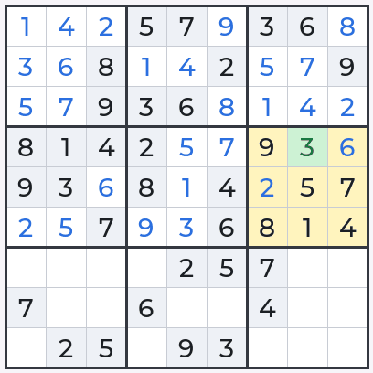

<!-- Written by tools/walkthrough.py chess-sudoku: edit the script, not this page. -->
# Chess Sudoku, step 28: the 3 in box 6

**Step 28 of 45** · [← Step 27](step-27.md) · [All steps](../chess-sudoku.md#the-whole-puzzle-step-by-step) · [Step 29 →](step-29.md)

Box 6 needs a 3, and r4c8 is its last empty cell: **r4c8 = 3**.

**Step 28 of 45** · [← Step 27](step-27.md) · [All steps](../chess-sudoku.md#the-whole-puzzle-step-by-step) · [Step 29 →](step-29.md)
