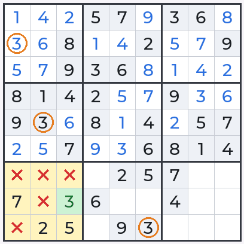

<!-- Written by tools/walkthrough.py chess-sudoku: edit the script, not this page. -->
# Chess Sudoku, step 29: the 3 in box 7

**Step 29 of 45** · [← Step 28](step-28.md) · [All steps](../chess-sudoku.md#the-whole-puzzle-step-by-step) · [Step 30 →](step-30.md)

Box 7 needs a 3. r7c1: column 1 has one (r2c1). r7c2 and r8c2: column 2 has one (r5c2). r7c3: the 3 in r5c2 is a knight's move away. r9c1: row 9 has one (r9c6). Only **r8c3** is left: **r8c3 = 3**.

**Step 29 of 45** · [← Step 28](step-28.md) · [All steps](../chess-sudoku.md#the-whole-puzzle-step-by-step) · [Step 30 →](step-30.md)
