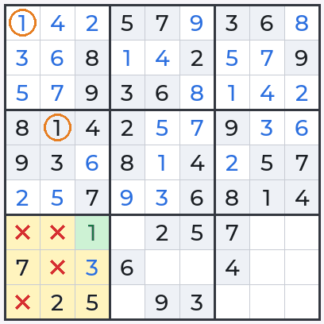

<!-- Written by tools/walkthrough.py chess-sudoku: edit the script, not this page. -->
# Chess Sudoku, step 30: the 1 in box 7

**Step 30 of 45** · [← Step 29](step-29.md) · [All steps](../chess-sudoku.md#the-whole-puzzle-step-by-step) · [Step 31 →](step-31.md)

Box 7 needs a 1. r7c1 and r9c1: column 1 has one (r1c1). r7c2 and r8c2: column 2 has one (r4c2). Only **r7c3** is left: **r7c3 = 1**.

**Step 30 of 45** · [← Step 29](step-29.md) · [All steps](../chess-sudoku.md#the-whole-puzzle-step-by-step) · [Step 31 →](step-31.md)
