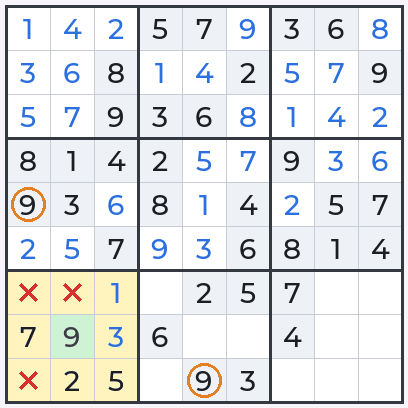

<!-- Written by tools/walkthrough.py chess-sudoku: edit the script, not this page. -->
# Chess Sudoku, step 31: the 9 in box 7

**Step 31 of 45** · [← Step 30](step-30.md) · [All steps](../chess-sudoku.md#the-whole-puzzle-step-by-step) · [Step 32 →](step-32.md)

Box 7 needs a 9. r7c1: column 1 has one (r5c1). r7c2: the 9 in r5c1 is a knight's move away. r9c1: row 9 has one (r9c5). Only **r8c2** is left: **r8c2 = 9**.

**Step 31 of 45** · [← Step 30](step-30.md) · [All steps](../chess-sudoku.md#the-whole-puzzle-step-by-step) · [Step 32 →](step-32.md)
