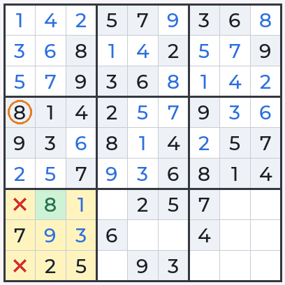

<!-- Written by tools/walkthrough.py chess-sudoku: edit the script, not this page. -->
# Chess Sudoku, step 32: the 8 in box 7

**Step 32 of 45** · [← Step 31](step-31.md) · [All steps](../chess-sudoku.md#the-whole-puzzle-step-by-step) · [Step 33 →](step-33.md)

Box 7 needs an 8. r7c1 and r9c1: column 1 has one (r4c1). Only **r7c2** is left: **r7c2 = 8**.

**Step 32 of 45** · [← Step 31](step-31.md) · [All steps](../chess-sudoku.md#the-whole-puzzle-step-by-step) · [Step 33 →](step-33.md)
