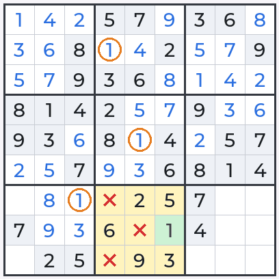

<!-- Written by tools/walkthrough.py chess-sudoku: edit the script, not this page. -->
# Chess Sudoku, step 33: the 1 in box 8

**Step 33 of 45** · [← Step 32](step-32.md) · [All steps](../chess-sudoku.md#the-whole-puzzle-step-by-step) · [Step 34 →](step-34.md)

Box 8 needs a 1. r7c4: row 7 has one (r7c3). r8c5: column 5 has one (r5c5). r9c4: column 4 has one (r2c4). Only **r8c6** is left: **r8c6 = 1**.

**Step 33 of 45** · [← Step 32](step-32.md) · [All steps](../chess-sudoku.md#the-whole-puzzle-step-by-step) · [Step 34 →](step-34.md)
