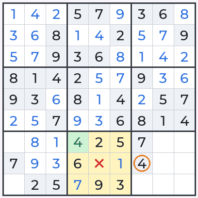

<!-- Written by tools/walkthrough.py chess-sudoku: edit the script, not this page. -->
# Chess Sudoku, step 35: the 4 in box 8

**Step 35 of 45** · [← Step 34](step-34.md) · [All steps](../chess-sudoku.md#the-whole-puzzle-step-by-step) · [Step 36 →](step-36.md)

Box 8 needs a 4. r8c5: row 8 has one (r8c7). Only **r7c4** is left: **r7c4 = 4**.

**Step 35 of 45** · [← Step 34](step-34.md) · [All steps](../chess-sudoku.md#the-whole-puzzle-step-by-step) · [Step 36 →](step-36.md)
